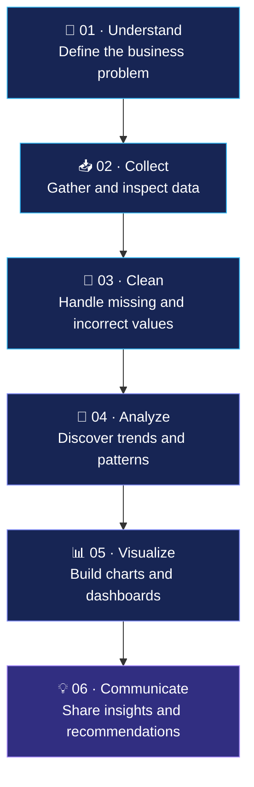

<!-- ================= PROFILE HEADER ================= -->

  
  
  

**I turn data into insights that help people make better decisions.**

---

## 👨‍💻 About Me

Hi! I'm **Awan Mansuri**, an MSc IT student interested in Data Analytics, Business Intelligence, and Artificial Intelligence.

I enjoy exploring datasets, identifying patterns, analyzing business performance, and presenting findings through reports and dashboards.

- 🎓 **Education:** MSc IT, with an interest in AI/ML
- 📍 **Location:** Ahmedabad, Gujarat, India
- 📊 **Primary interests:** Data Analytics, MIS, Reporting and Business Intelligence
- 🧰 **Tools:** Excel, SQL, Python, Power BI and data visualization tools
- 🧠 **Learning focus:** Analytical problem-solving, dashboard development and machine learning
- 💼 **Career goal:** Data Analyst internships and entry-level analytics roles

> 💡 My goal is to combine technical skills with business understanding to turn raw data into useful insights.

---

## 🛠️ Skills & Technologies

### Data Analytics & Business Intelligence

  
  
  
  
  
  

### Core Concepts

---

## 🚀 Featured Projects

<table>
<tr>
<td width="50%" valign="top">

### 📊 Excel Projects

- Superstore Sales Dashboard
- Student Performance Analysis
- Personal Budget Analysis

**Focus:** KPIs, reporting, charts and business insights

</td>
<td width="50%" valign="top">

### 🗄️ SQL Projects

- Online Retail RFM Analysis
- Bank Fraud Detection

**Focus:** Queries, joins, aggregation and customer analysis

</td>
</tr>

<tr>
<td width="50%" valign="top">

### 📈 Power BI — Sales Dashboard

- Revenue and Win Rate KPIs
- Average Deal Size
- Average Sales Cycle Days
- Quarterly performance trends
- Sales-stage funnel
- Quarter slicer and comparisons

**Tools:** Power BI, DAX and data modeling

</td>
<td width="50%" valign="top">

### 🐍 Python Projects

- Data cleaning and preparation
- Exploratory data analysis
- Statistical analysis
- Data visualization

**Focus:** Data exploration and analytical insights

</td>
</tr>

<tr>
<td width="50%" valign="top">

### 🧠 AI & Machine Learning

- Machine learning fundamentals
- Data preprocessing
- Feature selection
- Model evaluation

**Focus:** Applying analytical methods to datasets

</td>
<td width="50%" valign="top">

### 🔎 Explore More

Browse my other repositories to see additional projects, code and experiments.

</td>
</tr>
</table>

---

## 🔄 My Data Analytics Workflow

---

## 📈 GitHub Statistics

 

---

## 🎯 Career Goals

I'm interested in opportunities where I can apply my analytical skills, learn from experienced professionals, and contribute to real business problems.

- 📊 Data Analyst Intern / Junior Data Analyst
- 📋 MIS Executive / Reporting Analyst
- 📈 Business Intelligence Intern
- 📉 Power BI Intern
- 🧠 AI/ML Intern

**Preferred locations:** Ahmedabad, Gujarat, and remote opportunities across India.

---

## 📚 Currently Improving

- Writing better SQL queries
- Building clear, useful dashboards
- Improving Python data analysis
- Learning Power BI data modeling and DAX
- Strengthening statistics and machine learning fundamentals

---

## 🤝 Let's Connect

I'm open to connecting with recruiters, fellow analysts, and professionals working in data analytics and business intelligence.

  

**⭐ Thanks for visiting my profile!**

*Learning continuously • Analyzing thoughtfully • Growing through projects*

 

> “Data is the new oil, but insights are the real value.”

